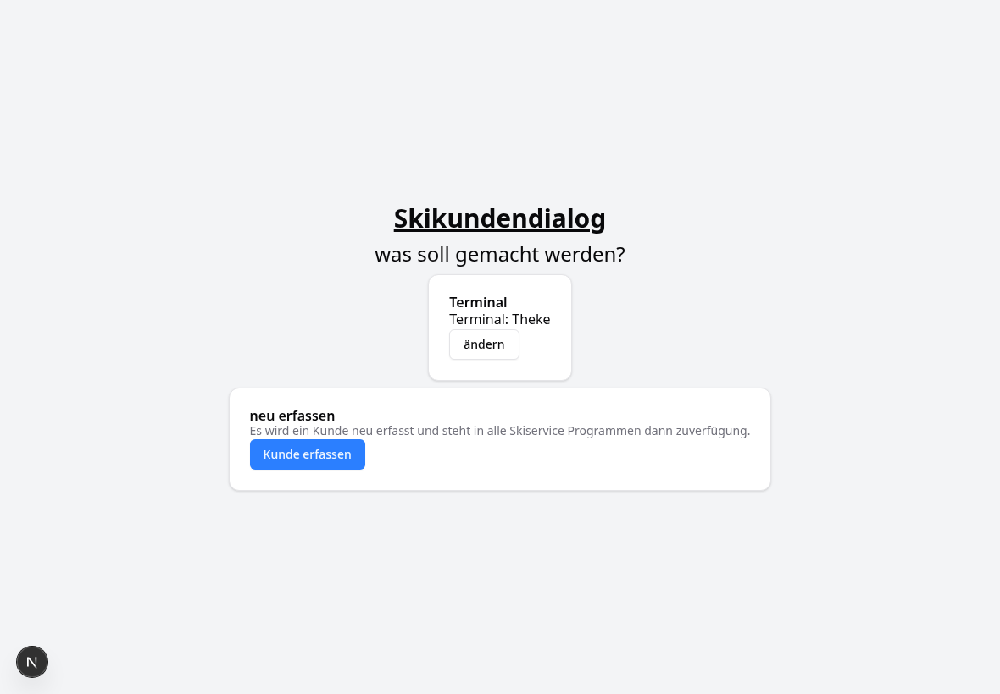
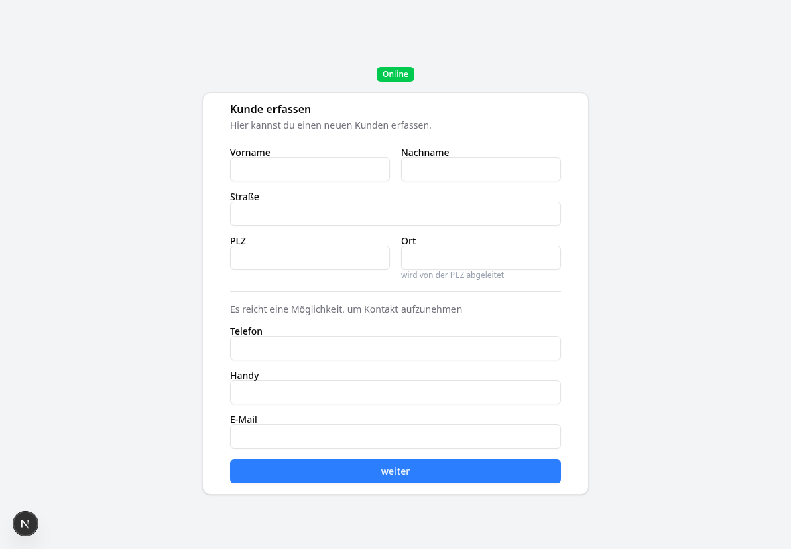

# Ski Kundendialog

Kundenterminal für ein Tablet an der Theke. Kunden erfassen ihre Daten selbst oder prüfen sie, wenn ein Mitarbeiter sie aus dem [Skiservice Center](https://github.com/SimonLoeffler1993/skiservice-center) auf das Terminal schickt. Die Daten gehen an die [Skiservice API](https://github.com/SimonLoeffler1993/skiserviceapi).

| Start | Kunde erfassen |
|---|---|
|  |  |

## Ablauf

1. Auf der Startseite einmalig einen **Terminalnamen** vergeben (z. B. „Theke“). Er wird im Browser des Tablets gespeichert.
2. Das Terminal verbindet sich per Server-Sent Events mit der API. Die Anzeige oben zeigt **Online** oder **Offline**; nach einem Verbindungsabbruch wird automatisch neu verbunden.
3. **Neuer Kunde:** Der Kunde füllt das Formular aus, der Ort wird aus der Postleitzahl ermittelt.
4. **Bestehender Kunde:** Im Center auf „Kunde ans Terminal senden“ klicken. Das Terminal zeigt die Daten zur Prüfung an, der Kunde korrigiert und bestätigt.

## Konfiguration

| Variable | Beschreibung |
|---|---|
| `BACKEND_URL` | Adresse der Skiservice API. Standard: `http://localhost:8000` |

Die Adresse wird an zwei Stellen verwendet:

- vom Next.js-Server für das Speichern der Kunden
- vom **Browser des Tablets** für die Live-Verbindung (abgerufen über `/api/config`)

Sie muss deshalb auch vom Tablet aus erreichbar sein. Ein interner Docker-Name wie `http://skiserviceapi:8000` funktioniert dafür nicht.

## Entwicklung

```bash
npm install
BACKEND_URL=http://localhost:8000 npm run dev   # http://localhost:3000
npm run lint
npm run build
```

Im Entwicklungsmodus die Seite über `http://localhost:3000` öffnen, nicht über `127.0.0.1`. Next.js blockiert sonst seine Skripte und die Seite bleibt ohne Funktion.

## Docker

Bei jedem Push auf `master` baut GitHub Actions das Image `ghcr.io/simonloeffler1993/ski-kunden-dialog:latest` (Next.js standalone, Port 3000). Ein Beispiel für den kompletten Stack liegt im Repository der API unter `docker/alles/`.
